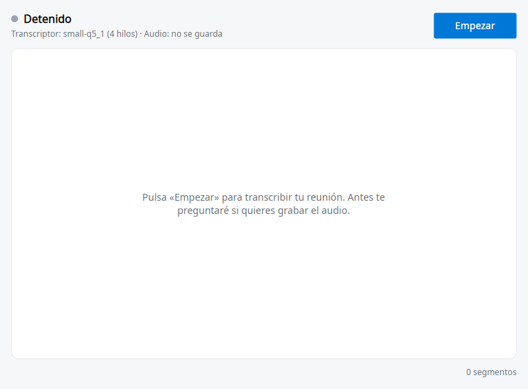
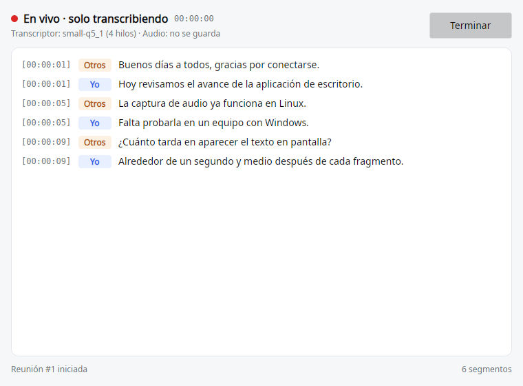
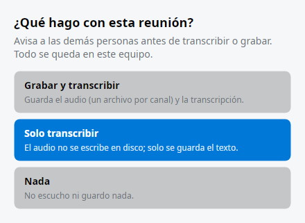

# Frente B — MeetAgent.Desktop (2026-10-15)

Ejecutar: `~/.dotnet/dotnet run --project app/src/MeetAgent.Desktop [-- --fake] [--model medium-q5_0] [--minimized]`

## Hecho
- Ícono en la bandeja: gris en reposo y con punto rojo en vivo. Menú: Empezar/Terminar, Mostrar ventana, Salir.
- Botón Empezar/Terminar con estados intermedios ("Preparando…", "Terminando…": al terminar espera a que la cola de Whisper se vacíe).
- Diálogo de consentimiento con 3 opciones; el foco por defecto está en «Solo transcribir». Esc o cerrar = «Nada».
- Vista en vivo `[hh:mm:ss] [Yo|Otros]` con etiqueta de color por hablante y desplazamiento automático (se detiene si subes a leer). Muestra el cronómetro, el transcriptor y si el audio se guarda o no.
- Composición: Whisper small real si existe `models/ggml-small-q5_1.bin`; si no, o con `--fake`, el transcriptor falso. Guarda en la misma `data/meetagent.db` que la CLI, y la grabación (solo con consentimiento) va a `data/recordings/reunion-{id}-{yo|otros}.wav`.

## Pruebas
- 5 en Core (`MeetingSession`): «Nada» no crea fuentes, grabadores ni reunión; «Solo transcribir» no abre grabadores; «Grabar» escribe 80 000 muestras por canal en 5 s; Stop cierra la reunión; no se permiten dos reuniones a la vez.
- 7 en Desktop (headless): el ViewModel con las 3 opciones, cada botón del diálogo, Esc y cerrar, y 3 capturas renderizadas.
- Arranque real en Ubuntu 24.04 (GNOME, Wayland) con `--fake --minimized`: corrió 6 s sin errores.

## Capturas (transcriptor falso)

## Sigue
- Probarla con Alejandro con audio real (Whisper small en vivo).
- Verificar la bandeja en Windows.
